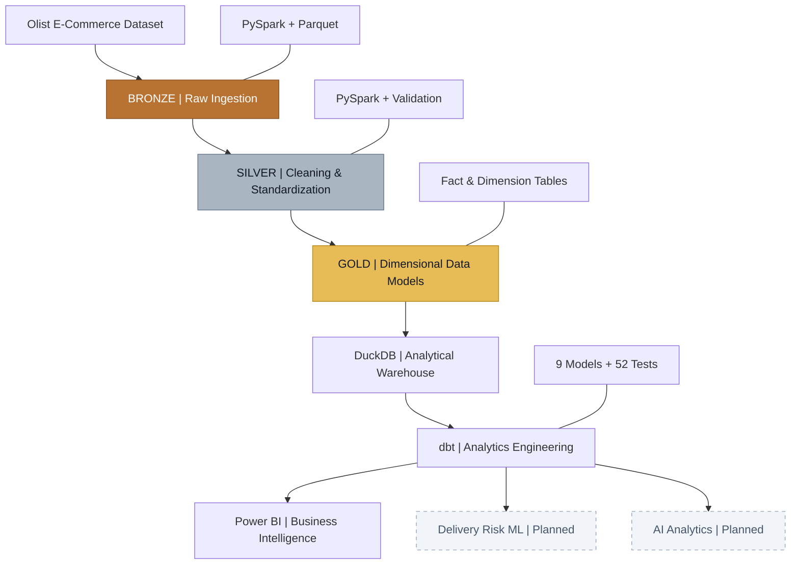

# Marketplace Intelligence & AI Platform

### End-to-End Data Engineering | Analytics Engineering | Business Intelligence | Predictive Analytics

An end-to-end marketplace intelligence platform designed to transform raw Brazilian e-commerce data into validated, business-ready analytical datasets.

The project demonstrates practical implementation of Medallion Architecture, distributed data processing, dimensional modeling, analytics engineering, automated data quality testing, and business intelligence development.

## Technology Stack

**Data Engineering:** Python, PySpark, Apache Parquet

**Data Warehousing:** DuckDB, SQL

**Analytics Engineering:** dbt Core, SQL, YAML

**Data Quality:** Automated validation, reconciliation, dbt tests

**Business Intelligence:** Power BI (in progress)

**Machine Learning & AI:** Planned development

## Data Architecture

The platform follows a Medallion Architecture with three transformation layers:

**Bronze — Raw Ingestion**
- Ingests source datasets using PySpark.
- Preserves source-level data for downstream processing.
- Stores intermediate datasets in Parquet format.

**Silver — Data Cleaning & Standardization**
- Standardizes data types and structures.
- Applies cleaning and validation logic.
- Prepares consistent datasets for dimensional modeling.

**Gold — Business-Ready Data**
- Produces fact and dimension tables.
- Supports customer, order, product, seller, payment, and review analytics.
- Applies automated data quality checks.

**Analytics Engineering — DuckDB + dbt**
- Builds nine analytical models.
- Implements automated integrity and consistency tests.
- Documents model dependencies and data lineage.

**Business Intelligence — Power BI**
- Interactive reporting and executive dashboards are in development.

## Current Implementation

- 8 Gold-layer fact and dimension tables
- 9 analytical dbt models
- 33 Gold-layer validation checks
- 52 automated dbt tests
- Successful dbt build: 61/61
- Customer RFM segmentation and cohort retention analysis
- Financial reconciliation and delivery performance analytics
- Delivery-risk feature engineering

## Architecture & Data Lineage

The platform implements a Medallion Architecture, transforming raw marketplace data into validated analytical models.

### dbt Data Lineage

The lineage graph below illustrates the dependencies between Gold-layer data sources, analytical models, and automated integrity tests.

The project includes nine dbt analytical models and 52 automated tests, with a successful build of 61 out of 61 resources.

## Development Roadmap

- [x] Medallion Architecture and PySpark pipelines
- [x] Gold-layer dimensional modeling and validation
- [x] DuckDB analytical warehouse
- [x] dbt models, tests, and documentation
- [ ] Power BI semantic model and dashboards
- [ ] Machine learning for delivery-risk prediction
- [ ] AI-powered analytics capabilities
- [ ] Deployment and production-readiness improvements

## Dataset

Built using the publicly available Olist Brazilian E-Commerce dataset.

Raw datasets are not included in this repository.

## Project Status

**Active development.** The data engineering and analytics engineering foundations are implemented and validated. Business intelligence, predictive analytics, and AI capabilities are being developed.