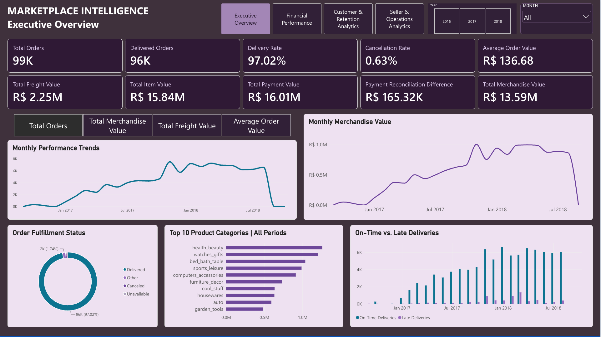
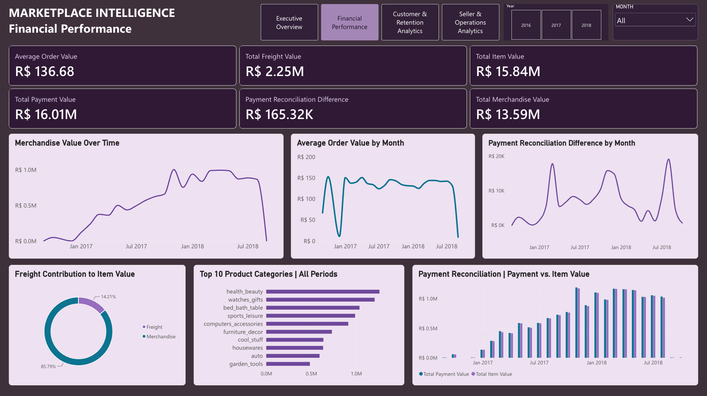
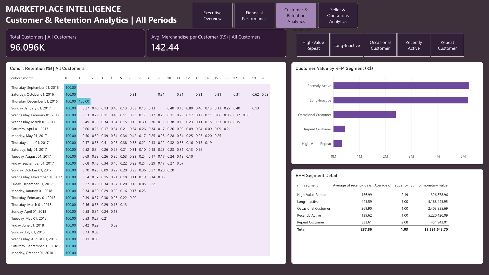
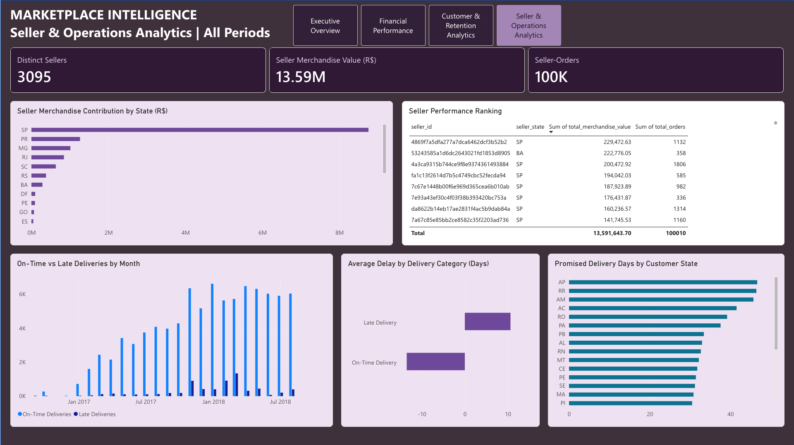
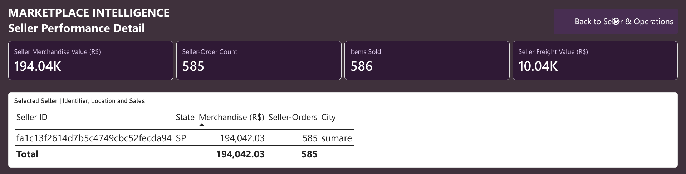
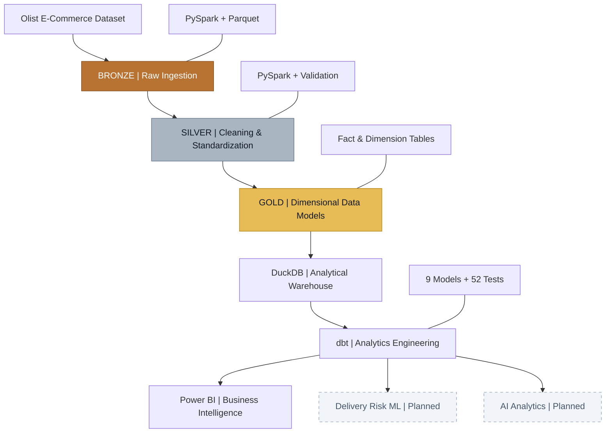
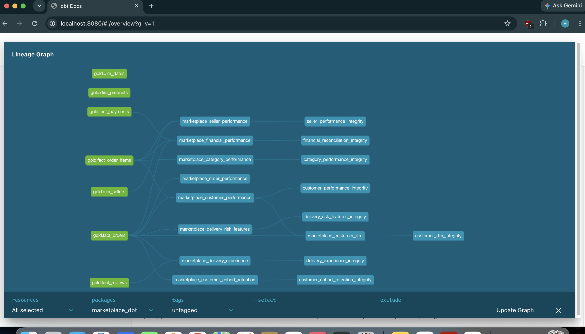

# Marketplace Intelligence & AI Platform

### End-to-End Data Engineering | Analytics Engineering | Business Intelligence | Predictive Analytics

An end-to-end marketplace intelligence platform designed to transform raw Brazilian e-commerce data into validated, business-ready analytical datasets and interactive decision-support reporting.

The project demonstrates practical implementation of Medallion Architecture, distributed data processing, dimensional modeling, analytics engineering, automated data quality testing, and interactive business intelligence.

## Technology Stack

**Data Engineering:** Python, PySpark, Apache Parquet

**Data Warehousing:** DuckDB, SQL

**Analytics Engineering:** dbt Core, SQL, YAML

**Data Quality:** Automated validation, reconciliation, dbt tests

**Business Intelligence:** Power BI, DAX, interactive dashboards, drill-through, field parameters

**Machine Learning & AI:** Planned development

## Data Architecture

The platform follows a Medallion Architecture with three transformation layers:

**Bronze — Raw Ingestion**
- Ingests source datasets using PySpark.
- Preserves source-level data for downstream processing.
- Stores intermediate datasets in Parquet format.

**Silver — Data Cleaning & Standardization**
- Standardizes data types and structures.
- Applies cleaning and validation logic.
- Prepares consistent datasets for dimensional modeling.

**Gold — Business-Ready Data**
- Produces fact and dimension tables.
- Supports customer, order, product, seller, payment, and review analytics.
- Applies automated data quality checks.

**Analytics Engineering — DuckDB + dbt**
- Builds nine analytical models.
- Implements automated integrity and consistency tests.
- Documents model dependencies and data lineage.

**Business Intelligence — Power BI**
- Delivers a completed five-page interactive Power BI report.
- Provides executive, financial, customer, and seller performance analysis.
- Implements synchronized date slicers, dynamic metric switching, RFM segmentation, and seller drill-through.
- Supports interactive cross-filtering while preserving explicitly labeled all-period analyses.

## Power BI | Executive Command Center

The Business Intelligence component is complete.

The **Marketplace Intelligence | Executive Command Center** provides an interactive analytical experience across four primary report pages and one seller drill-through page.

### Executive Overview

Tracks order volume, merchandise value, delivery performance, order status, and product category performance.

Includes synchronized Year and Month slicers, interactive cross-filtering, and a four-metric selector for Total Orders, Merchandise Value, Freight Value, and Average Order Value.

### Financial Performance

Examines merchandise value, freight contribution, average order value, payment reconciliation, and monthly financial trends.

### Customer & Retention Analytics

Explores customer behaviour through RFM segmentation, cohort retention, and observed customer value.

Includes interactive RFM segment filtering, while cohort retention and overall customer KPIs retain their all-customer scope.

### Seller & Operations Analytics

Analyzes seller merchandise contribution, seller-order activity, delivery timeliness, and operational performance.

Includes drill-through functionality to individual seller profiles showing merchandise value, seller-orders, items sold, freight value, and seller location.

**[View detailed Power BI documentation](powerbi/README.md)**

### Seller Performance Detail | Drill-Through

An interactive seller-level analysis accessible through
**Seller & Operations Intelligence → Drill through → Seller Performance Detail**.

The page displays merchandise value, seller-order count,
items sold, freight value, and seller location.

A dedicated Back button returns users to the seller
ranking, enabling navigation between marketplace-wide
performance and individual seller profiles.

Drill-through metrics were validated against the seller
ranking table using multiple seller records.

## Current Implementation

- 8 Gold-layer fact and dimension tables
- 9 analytical dbt models
- 33 Gold-layer validation checks
- 52 automated dbt tests
- Successful dbt build: 61/61
- Customer RFM segmentation and cohort retention analysis
- Financial reconciliation and delivery performance analytics
- Delivery-risk feature engineering
- Completed five-page Power BI report
- Four-metric interactive field parameter
- Synchronized date filtering and chart interactions
- Customer RFM segment filtering
- Seller performance drill-through

## Architecture & Data Lineage

The platform implements a Medallion Architecture, transforming raw marketplace data into validated analytical models and interactive reporting.

### dbt Data Lineage

The lineage graph below illustrates the dependencies between Gold-layer data sources, analytical models, and automated integrity tests.

The project includes nine dbt analytical models and 52 automated tests, with a successful build of 61 out of 61 resources.

## Development Roadmap

- [x] Medallion Architecture and PySpark pipelines
- [x] Gold-layer dimensional modeling and validation
- [x] DuckDB analytical warehouse
- [x] dbt models, tests, and documentation
- [x] Power BI semantic model and interactive dashboards
- [ ] Machine learning for delivery-risk prediction
- [ ] AI-powered analytics capabilities
- [ ] Deployment and production-readiness improvements

## Dataset

Built using the publicly available Olist Brazilian E-Commerce dataset.

Raw datasets are not included in this repository.

**Data interpretation notes:**
- Merchandise value is not equivalent to recognized revenue.
- Seller-orders are not necessarily unique marketplace orders.
- Observed customer value is not predicted customer lifetime value.
- September and October 2018 contain unusually low order counts; the available data does not establish why.

## Project Status

**Active development.**

The data engineering, analytics engineering, and business intelligence components are implemented and validated.

The five-page Power BI Executive Command Center is complete. Machine learning, AI-powered analytics, and deployment improvements remain future development phases.