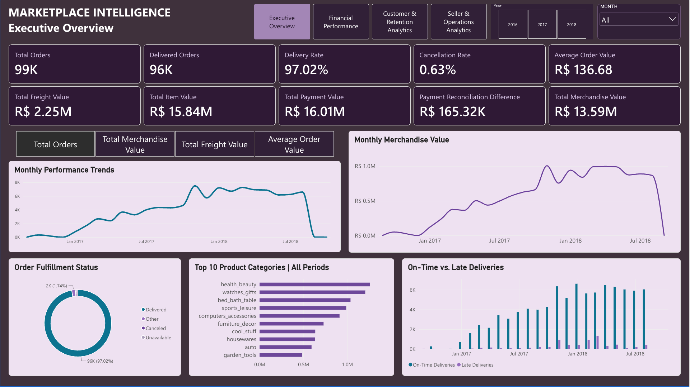
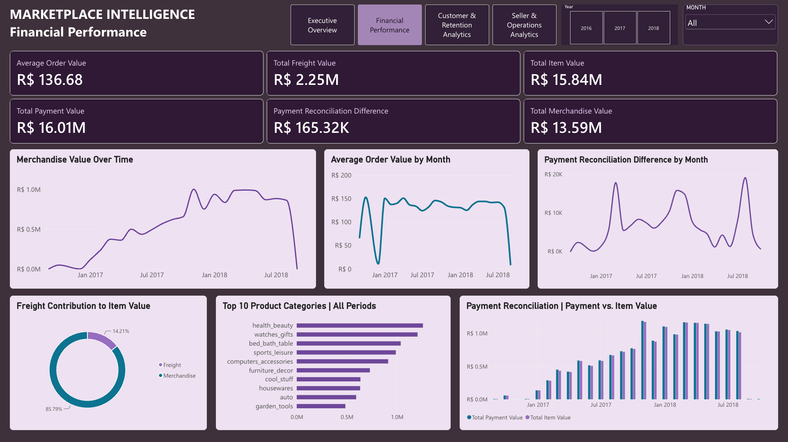
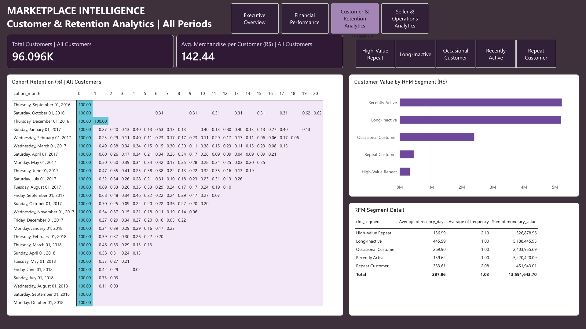
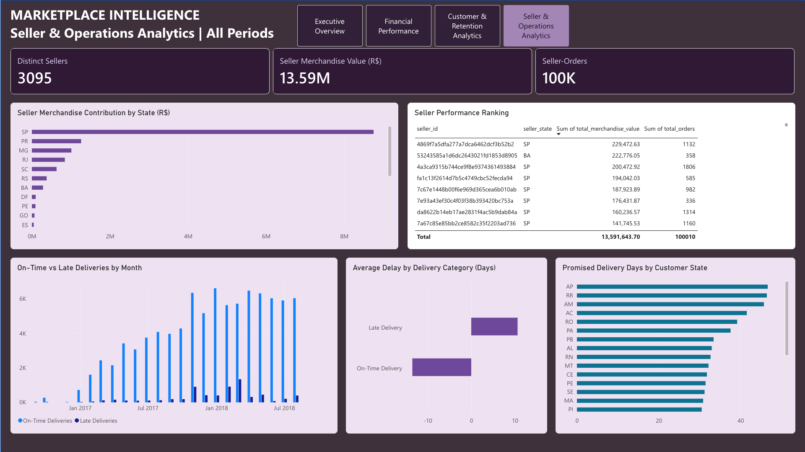
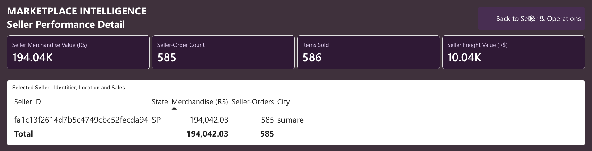
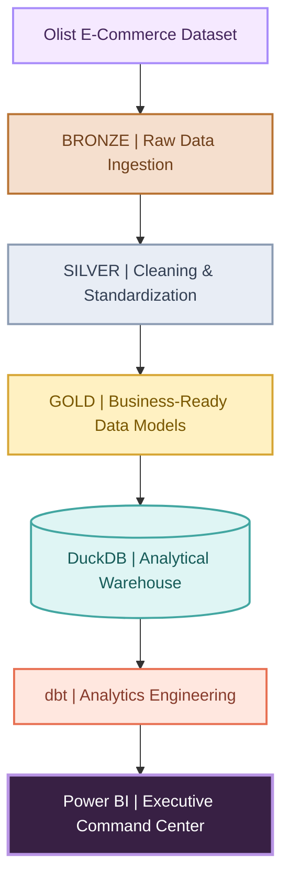

# Marketplace Intelligence | Executive Command Center

## Overview

A five-page interactive Power BI report developed as the Business Intelligence component of the **Marketplace Intelligence & AI Platform**.

Built using the Brazilian Olist E-Commerce dataset, the report supports marketplace performance analysis across order activity, financial operations, customer retention, seller performance, and delivery operations.

The report includes four primary analytical pages and one contextual seller drill-through page.

## Report Pages

### 1. Executive Overview

Provides an executive-level view of marketplace performance, including:

- Total and delivered orders
- Delivery and cancellation rates
- Average order value
- Merchandise, freight, item, and payment values
- Order status and product category performance
- Monthly delivery performance

**Interactive capabilities:** synchronized Year and Month slicers, cross-filtering, page navigation, and a four-metric field parameter that switches the monthly trend between Total Orders, Merchandise Value, Freight Value, and Average Order Value.

### 2. Financial & Commercial Intelligence

Examines financial and commercial activity through:

- Monthly merchandise value
- Average order value trends
- Freight contribution
- Payment and item value comparisons
- Payment reconciliation differences
- Product category merchandise contribution

Year and Month slicers are synchronized with Executive Overview.

Merchandise value, item value, and payment value are treated as distinct metrics rather than interchangeable revenue measures.

### 3. Customer & Retention Intelligence

Analyzes customer purchasing behaviour using:

- Customer counts and observed merchandise value
- RFM customer segmentation
- Cohort retention analysis
- Segment-level recency, frequency, and monetary value

A five-button RFM slicer filters the segment value chart and detail table. The cohort heatmap and overall customer KPIs retain their **All Customers** scope.

### 4. Seller & Operations Intelligence

Examines seller and operational performance through:

- Seller merchandise contribution by state
- Seller-order activity
- Individual seller rankings
- On-time and late delivery trends
- Delivery delays and promised delivery durations

The seller ranking table supports contextual drill-through to individual seller profiles.

### 5. Seller Performance Detail | Drill-Through

A dedicated seller-level analysis page accessible from the Seller & Operations Intelligence ranking table.

**How to use:** Right-click a seller row and select **Drill through → Seller Performance Detail**.

The page displays:

- Seller merchandise value
- Seller-order count
- Items sold
- Freight value
- Seller identifier, state, and city

A **Back to Seller & Operations** button returns users to the seller ranking.

Drill-through functionality was tested against the original ranking table using multiple sellers, including:

| Seller Location | Merchandise Value | Seller-Orders |
|---|---:|---:|
| Guariba, SP | R$229,472.63 | 1,132 |
| Lauro de Freitas, BA | R$222,776.05 | 358 |

## Interactive Features

- Four-page navigation with active-page highlighting
- Synchronized Year and Month filters between Executive Overview and Financial Intelligence
- Dynamic four-metric trend selector using a Power BI field parameter
- Cross-filtering and cross-highlighting
- Interactive RFM customer segmentation
- Seller-level drill-through and return navigation
- Explicit All Periods and All Customers labels for analyses that do not respond to date or segment filters

## Data Pipeline

The report is the visualization layer of the broader platform.

## Data Validation and Interpretation

The underlying platform includes 33 Gold-layer validation checks and 52 automated dbt tests, with a successful dbt build of 61/61 resources.

Important interpretation notes:

- Merchandise value is not equivalent to recognized revenue.
- Payment reconciliation differences should not be interpreted as revenue.
- Seller-orders are not necessarily distinct marketplace orders.
- Observed customer value is not predicted customer lifetime value.
- September and October 2018 show unusually low order volumes. The available data does not establish the cause or confirm whether those months are complete.

## Report Validation

The report was tested in Power BI reading mode.

Verified functionality includes synchronized date filtering, metric selection and number formatting, RFM segment filtering, chart interactions, seller drill-through, and return navigation.

The saved defaults are all dates, Total Orders for the metric selector, and all RFM segments.

## Project Status

**Business Intelligence: Completed**

This report is a completed component of the ongoing Marketplace Intelligence & AI Platform.

Machine learning for delivery-risk prediction and AI-powered analytics are planned subsequent phases.

[Return to Main Project README](../README.md)